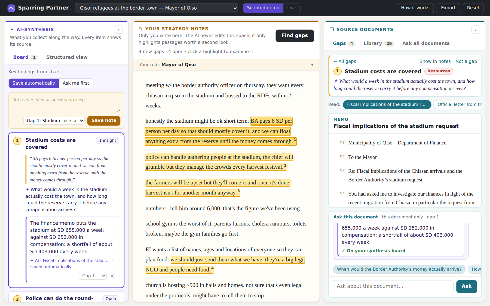

# Sparring Partner

A human-AI tool for preparing negotiations. You write your strategy in your own
words; the system points out the passages that rest on questionable assumptions,
opens the case documents that bear on them, and collects what you learn in a
separate, clearly labelled AI space. It asks questions instead of writing your
strategy for you.

**Current scope.** This version focuses on the interface between a person and
the case material: reading and understanding the documents, testing one's own
reasoning against them, and finding where claims are unsupported, contested or
inconsistent, both within one's notes and across sources. Rehearsing the
negotiation against a simulated counterpart (role play / replay) is planned for
a later version and is not part of this release.



## How it works

You start by choosing a case and the role you will play. The case screen then
has three columns:

| Column | Who writes there | What it does |
|---|---|---|
| **Your strategy notes** (centre) | only you | Free-flow notes. *Find gaps* highlights passages whose reasoning the documents call into question, each with a question rather than a verdict. After editing, press it again: revised passages are re-checked and clear once they no longer rest on the assumption, and new gaps are added. The same run marks in green the passages the documents confirm (hover for the source). The notes start with three prompts: **What do I want?**, **What does the other side want?** and **What’s my plan?** |
| **Source Documents** (right) | — | Click a highlight to read the documents behind it, each with its own chat (*Rabbit Hole*). Browse the full **Library**, or **Ask all documents** for questions that are not about one passage. Answers cite paragraphs. |
| **AI-Synthesis** (left) | AI, plus your own notes | A **Board** of insights from any chat and notes you jot down, filed under a gap or *General*, each labelled with its source. A **Structured view** restates your free-flow notes in negotiation terms (iceberg of positions, interests and values; island of agreement; stakeholders; red lines; alternatives; options) and lists what your notes leave open. |

Every AI claim links back to a document and paragraph, and every item in the
structured view links back to the phrase in your notes it came from.

## Quick start

**Scripted demo (no install).** Serve the `web/` folder with any static server:

```bash
python3 -m http.server 8000 --directory web
# open http://localhost:8000
```

The demo plays the Mayor of Qiso preparing to meet a Border Authority officer,
with prepared gaps and answers. Other cases and roles work for browsing and
passage search.

**Full app.**

```bash
python3 -m venv .venv
.venv/bin/pip install -e ".[all]"
.venv/bin/sparring-partner serve          # http://127.0.0.1:8000
```

**Live mode** (any case, any notes) needs access to Claude, either through the
Claude API or through Amazon Bedrock:

```bash
cp .env.example .env     # then set ANTHROPIC_API_KEY, or AWS_BEARER_TOKEN_BEDROCK + AWS_REGION
.venv/bin/sparring-partner serve
```

Switch the top-bar toggle to *Live*. Without credentials the server still runs:
chats fall back to returning the best-matching passages.

## Cases

| Case | Roles |
|---|---|
| Qiso: refugees at the border town | Mayor of Qiso · Border Authority officer |
| Beta: detained surgical staff | HfA delegation · tribal council |
| Alpha: food access at the refugee camp | FWB delegate · Camp Commander |

Each case folder has a short introduction for newcomers: the situation, what
each role is preparing for, which documents to read first, and questions to keep
in mind ([Qiso](cases/qiso/README.md), [Beta](cases/beta-hospital/README.md),
[Alpha](cases/alpha-camp/README.md)). The same reading list appears in the app
under *Your role*.

Each role sees only its own documents plus the shared ones. When the Python
server is running, this barrier is enforced server-side for data, retrieval and
every model prompt. Built corpora are in `web/data/cases/`; to rebuild them from
the original files, place those under `cases_raw/` and run
`sparring-partner ingest`. To add a case, see
[docs/adding-a-case.md](docs/adding-a-case.md).

## Configuration

Set in the environment or in `.env`:

| Variable | Default | Purpose |
|---|---|---|
| `ANTHROPIC_API_KEY` | — | Enables live mode through the Claude API |
| `AWS_BEARER_TOKEN_BEDROCK` | — | Enables live mode through Amazon Bedrock (a Bedrock API key) |
| `AWS_REGION` | `us-east-1` | Bedrock region where the Claude models are enabled |
| `SPARRING_PROVIDER` | `auto` | `anthropic` or `bedrock`; `auto` uses Bedrock when only a Bedrock key is set |
| `SPARRING_LLM_MODE` | `auto` | `auto`, `anthropic` (require a model) or `offline` |
| `SPARRING_MODEL` | `claude-opus-5-5` (`anthropic.claude-opus-5-5` on Bedrock) | Model for all tasks |
| `SPARRING_EFFORT_GAPS` / `_CHAT` / `_STRUCTURE` / `_SUPPORT` | `high` / `low` / `medium` / `medium` | Reasoning effort per task |
| `SPARRING_FALLBACKS` | `default` (`off` on Bedrock) | Server-side refusal fallback (`off` to disable) |
| `SPARRING_RAW_DIR` | `cases_raw` | Raw case files for ingestion |
| `SPARRING_ACCEPT_SESSION_LOGS` | `0` | `1` lets the browser post sessions to `/api/sessions` |

## Deploying

The repository is ready for [Vercel](https://vercel.com): `vercel.json` serves
`web/` as a static site and runs the API as a Python function from
`api/index.py`.

```bash
npx vercel login
npx vercel            # preview deployment; add --prod for production
```

Without credentials the deployment runs the scripted demo. For live mode, add
`AWS_BEARER_TOKEN_BEDROCK` and `AWS_REGION` (or `ANTHROPIC_API_KEY`) under the
project's environment variables and redeploy. Note that the static site also
serves the built corpora in `web/data/cases/`, so every role's documents are
publicly readable on a hosted copy; only deploy cases you are allowed to publish.

Any other static host works for the demo alone (serve `web/`).

## Research use

Sessions persist in the browser per case, role and mode. **Export session**
downloads the notes, gaps, insights, chat threads, structured view and a
timestamped interaction log as JSON. For studies, enable
`SPARRING_ACCEPT_SESSION_LOGS` to collect sessions on the server. Key findings
from chats are always saved to the board automatically.

## Project layout

```
sparring_partner/   Python package: ingestion, retrieval, agents, API, CLI
web/                browser app (ES modules, no build step) and built data
cases/              case manifests and starter notes
docs/               architecture, design notes, adding a case
prototypes/v1/      the first static prototype
tests/              unit, API and corpus tests
```

See [docs/architecture.md](docs/architecture.md) for how the pieces fit and
[docs/design-notes.md](docs/design-notes.md) for the design rationale.

## Development

```bash
make install
make test           # pytest
make serve          # auto-reload
```

Contributions are welcome; see [CONTRIBUTING.md](CONTRIBUTING.md).

## License

Code is released under the [MIT License](LICENSE). The case materials are
teaching simulations and are not covered by it; see [cases/README.md](cases/README.md).
