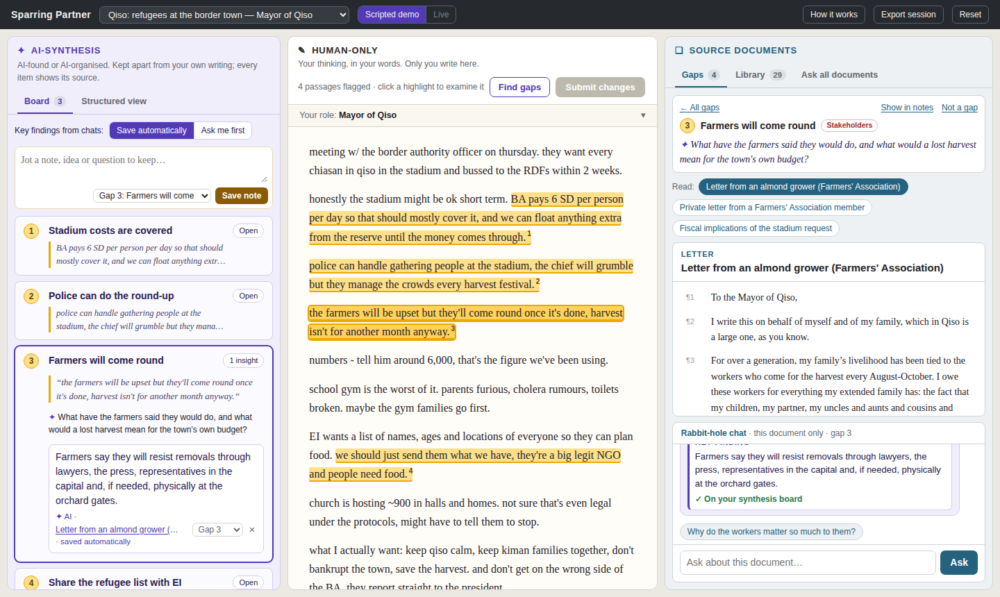

# Sparring Partner

A human-AI tool for preparing negotiations. You write your strategy in your own
words; the system points out the passages that rest on questionable assumptions,
opens the case documents that bear on them, and collects what you learn in a
separate, clearly labelled AI space. It asks questions instead of writing your
strategy for you.

**Current scope.** This version focuses on the interface between a person and
the case material: reading and understanding the documents, testing one's own
reasoning against them, and finding where claims are unsupported, contested or
inconsistent, both within one's notes and across sources. Rehearsing the
negotiation against a simulated counterpart (role play / replay) is planned for
a later version and is not part of this release.



## How it works

The screen has three columns:

| Column | Who writes there | What it does |
|---|---|---|
| **Human-Only** (centre) | only you | Free-flow notes. *Find gaps* highlights passages whose reasoning the documents call into question, each with a question rather than a verdict. Edit a passage and *Submit changes* to re-check it. |
| **Source Documents** (right) | — | Click a highlight to read the documents behind it, with a separate "rabbit-hole" chat per document. Browse the full **Library**, or **Ask all documents** for questions that are not about one passage. Answers cite paragraphs. |
| **AI-Synthesis** (left) | AI, plus your own notes | A **Board** of insights from any chat and notes you jot down, filed under a gap or *General*, each labelled with its source. A **Structured view** restates your free-flow notes in negotiation terms (iceberg of positions, interests and values; island of agreement; stakeholders; red lines; alternatives; options) and lists what your notes leave open. |

Every AI claim links back to a document and paragraph, and every item in the
structured view links back to the phrase in your notes it came from.

## Quick start

**Scripted demo (no install).** Serve the `web/` folder with any static server:

```bash
python3 -m http.server 8000 --directory web
# open http://localhost:8000
```

The demo plays the Mayor of Qiso preparing to meet a Border Authority officer,
with prepared gaps and answers. Other cases and roles work for browsing and
passage search.

**Full app.**

```bash
python3 -m venv .venv
.venv/bin/pip install -e ".[all]"
.venv/bin/sparring-partner serve          # http://127.0.0.1:8000
```

**Live mode** (any case, any notes) needs Claude API access:

```bash
cp .env.example .env                       # then set ANTHROPIC_API_KEY
.venv/bin/sparring-partner serve
```

Switch the top-bar toggle to *Live*. Without credentials the server still runs:
chats fall back to returning the best-matching passages.

## Cases

| Case | Roles |
|---|---|
| Qiso: refugees at the border town | Mayor of Qiso · Border Authority officer |
| Beta: detained surgical staff | HfA delegation · tribal council |
| Alpha: food access at the refugee camp | FWB delegate · Camp Commander |

Each role sees only its own documents plus the shared ones. When the Python
server is running, this barrier is enforced server-side for data, retrieval and
every model prompt. Built corpora are in `web/data/cases/`; to rebuild them from
the original files, place those under `cases_raw/` and run
`sparring-partner ingest`. To add a case, see
[docs/adding-a-case.md](docs/adding-a-case.md).

## Configuration

Set in the environment or in `.env`:

| Variable | Default | Purpose |
|---|---|---|
| `ANTHROPIC_API_KEY` | — | Enables live mode |
| `SPARRING_LLM_MODE` | `auto` | `auto`, `anthropic` (require a model) or `offline` |
| `SPARRING_MODEL` | `claude-opus-5-5` | Model for all tasks |
| `SPARRING_EFFORT_GAPS` / `_CHAT` / `_STRUCTURE` | `high` / `low` / `medium` | Reasoning effort per task |
| `SPARRING_FALLBACKS` | `default` | Server-side refusal fallback (`off` to disable) |
| `SPARRING_RAW_DIR` | `cases_raw` | Raw case files for ingestion |
| `SPARRING_ACCEPT_SESSION_LOGS` | `0` | `1` lets the browser post sessions to `/api/sessions` |

## Research use

Sessions persist in the browser per case, role and mode. **Export session**
downloads the notes, gaps, insights, chat threads, structured view and a
timestamped interaction log as JSON. For studies, enable
`SPARRING_ACCEPT_SESSION_LOGS` to collect sessions on the server, and use the
*Save automatically / Ask me first* toggle to compare how findings reach the
board.

## Project layout

```
sparring_partner/   Python package: ingestion, retrieval, agents, API, CLI
web/                browser app (ES modules, no build step) and built data
cases/              case manifests and starter notes
docs/               architecture, design notes, adding a case
prototypes/v1/      the first static prototype
tests/              unit, API and corpus tests
```

See [docs/architecture.md](docs/architecture.md) for how the pieces fit and
[docs/design-notes.md](docs/design-notes.md) for the design rationale.

## Development

```bash
make install
make test           # pytest
make serve          # auto-reload
```

Contributions are welcome; see [CONTRIBUTING.md](CONTRIBUTING.md).

## License

Code is released under the [MIT License](LICENSE). The case materials are
teaching simulations and are not covered by it; see [cases/README.md](cases/README.md).
